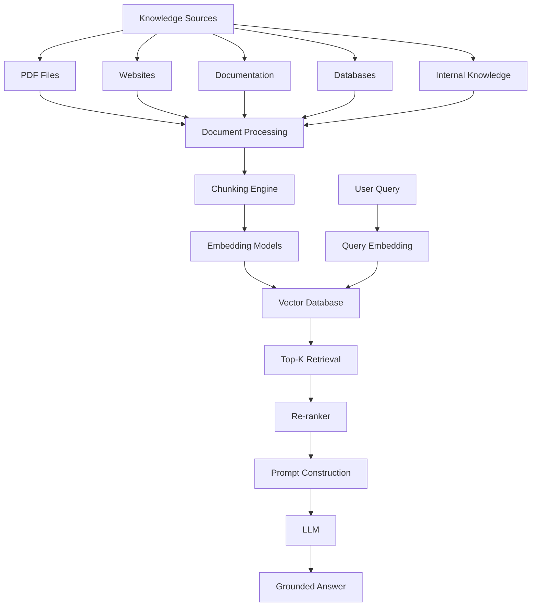

<div align="center">

# NEXUS

### Enterprise-Grade Retrieval Augmented Generation Platform


<p align="center">
  
  
  
  
</p>

### Building AI Systems That Retrieve Knowledge Before Generating Answers

</div>

---

# 📖 Introduction

Large Language Models are powerful, but they have fundamental limitations.

They can generate incorrect information, struggle with private organizational knowledge, and cannot access newly created information after training.

**NEXUS solves this problem through Retrieval-Augmented Generation (RAG).**

Instead of relying solely on model memory, NEXUS retrieves relevant information from trusted knowledge sources and provides that context to the language model before generating a response.

This results in:

- Higher factual accuracy
- Reduced hallucinations
- Better explainability
- Real-time knowledge integration
- Enterprise-scale intelligence

---

# 🚀 What is Retrieval-Augmented Generation?

Retrieval-Augmented Generation (RAG) is an AI architecture that combines:

### Retrieval Systems

Responsible for finding relevant information from external knowledge sources.

### Vector Databases

Store semantic representations of documents.

### Embedding Models

Convert text into high-dimensional vectors.

### Large Language Models

Generate natural language responses based on retrieved context.

The model does not answer immediately.

Instead, it first retrieves evidence and then generates the final response.

---

# 🎯 Why RAG?

Traditional AI systems suffer from multiple challenges:

| Challenge | Impact |
|------------|---------|
| Hallucinations | Incorrect answers |
| Knowledge Cutoff | Outdated information |
| No Transparency | Unverifiable outputs |
| Expensive Fine-Tuning | Difficult updates |
| Limited Domain Knowledge | Poor specialization |

RAG addresses these challenges by grounding responses in real-world information.

---

# ⚡ Core Philosophy

> Never generate knowledge when you can retrieve knowledge.

NEXUS prioritizes factual grounding over probabilistic guessing.

Every answer is generated using retrieved context rather than relying solely on model training data.

---

# 🏗 System Architecture



---

# 🔄 End-to-End Pipeline

## 1. Knowledge Ingestion

Knowledge is collected from multiple data sources.

Supported data types include:

- PDF Documents
- Documentation Portals
- Knowledge Bases
- SQL Databases
- CSV Files
- Internal Wikis
- API Responses
- Research Papers

The ingestion layer standardizes all information into a unified format.

---

## 2. Document Processing

Raw documents often contain noise.

The processing stage handles:

- Cleaning
- Normalization
- Metadata Extraction
- Language Detection
- Formatting Optimization

Output becomes retrieval-ready content.

---

## 3. Chunking Strategy

Large documents cannot be embedded directly.

Instead, content is divided into smaller chunks.

### Example

```text
Document:
25 Pages

↓

Chunk 1
Chunk 2
Chunk 3
Chunk 4
...
Chunk N
```

Benefits:

- Faster retrieval
- Better relevance
- Improved context quality

---

## 4. Embedding Generation

Each chunk is transformed into a vector representation.

```text
"The Earth revolves around the Sun."

↓

[0.482, -0.193, 0.940, ...]
```

Embeddings capture semantic meaning rather than exact words.

This enables:

- Semantic Search
- Similarity Matching
- Context Discovery

---

# 🧠 Vector Intelligence

Unlike traditional search systems, vector search understands meaning.

Example:

### User Query

```text
How does authentication work?
```

### Retrieved Content

```text
User login process
JWT validation
Session management
```

Even if exact keywords do not match, semantic similarity enables successful retrieval.

---

# 🔍 Retrieval Engine

The retrieval layer finds the most relevant knowledge.

NEXUS supports:

### Dense Retrieval

Embedding-based search.

### Sparse Retrieval

Keyword-based search.

### Hybrid Retrieval

Combines semantic and keyword search for maximum accuracy.

```text
Dense Search
      +
Sparse Search
      =
Hybrid Retrieval
```

---

# 🎯 Re-Ranking Layer

Initial retrieval may contain partially relevant results.

Re-ranking improves quality by sorting retrieved documents according to actual relevance.

```text
Retrieved Results
        ↓
Cross Encoder
        ↓
Relevance Scoring
        ↓
Top Context Selection
```

Benefits:

✅ Reduced Noise

✅ Better Context

✅ Higher Accuracy

✅ Improved User Satisfaction

---

# 🤖 Context Construction

After retrieval, relevant information is assembled into a structured prompt.

```text
System Instructions

+

Retrieved Context

+

User Question

↓

Final Prompt
```

This creates grounded responses with factual support.

---

# 💡 Response Generation

The language model receives:

1. User Query
2. Retrieved Documents
3. System Instructions

The generated answer remains tied to retrieved evidence.

```text
Question

↓

Retrieve Knowledge

↓

Build Context

↓

Generate Response

↓

Return Answer
```

---

# 📚 Knowledge Grounding

Grounding ensures every generated response originates from retrieved evidence.

Benefits include:

- Source-backed answers
- Context awareness
- Greater trustworthiness
- Reduced hallucinations

Grounding transforms generative AI into knowledge-driven AI.

---

# ⚙️ AI Components

## Embedding Models

Used for vector generation.

Examples:

- BGE Large
- OpenAI Embeddings
- E5 Large
- Instructor XL
- GTE

---

## Language Models

Responsible for final generation.

Examples:

- GPT-4o
- Claude
- Gemini
- Llama
- Mistral

---

## Vector Databases

Store and retrieve embeddings efficiently.

Examples:

- ChromaDB
- Pinecone
- Qdrant
- Weaviate
- FAISS

---

# 📊 Evaluation Metrics

A production RAG system requires continuous evaluation.

### Retrieval Metrics

- Recall@K
- MRR
- Precision@K
- Hit Rate

### Generation Metrics

- Faithfulness
- Context Precision
- Context Recall
- Answer Relevancy

### System Metrics

- Latency
- Throughput
- Cache Hit Rate
- Token Consumption

---

# 🔒 Security and Governance

Enterprise AI systems require strong security practices.

Key capabilities include:

### Authentication

Secure user verification.

### Authorization

Role-based access policies.

### Encryption

Data protected at transit and rest.

### Audit Logs

Complete query tracking.

### Access Control

Knowledge permissions by user role.

---

# 📈 Observability

Every component should be measurable.

Monitor:

- Query Response Time
- Retrieval Accuracy
- Vector Search Latency
- Model Latency
- Token Usage
- Failure Rate

Visibility improves reliability and scalability.

---

# 🌍 Enterprise Use Cases

## Internal Knowledge Assistants

Instant answers from company documentation.

---

## Customer Support

Automated support powered by internal knowledge.

---

## Healthcare Systems

Knowledge retrieval from medical references.

---

## Legal Research

Accurate retrieval from legal documents.

---

## Financial Analysis

Context-aware investment research.

---

## Educational Platforms

Curriculum-driven intelligent tutoring systems.

---

# 🚀 Benefits

### Improved Accuracy

Responses are based on retrieved evidence.

### Real-Time Knowledge

No retraining required for updates.

### Lower Costs

Knowledge updates occur through indexing rather than model retraining.

### Explainability

Every answer can be linked to supporting information.

### Scalability

Supports millions of documents and users.

---

# 🔮 Future Roadmap

- Agentic RAG
- Graph RAG
- Multi-Modal RAG
- Video Retrieval
- Adaptive Chunking
- Knowledge Graph Integration
- Autonomous Research Agents
- Self-Improving Retrieval Pipelines

---

# 🌟 Vision

Artificial Intelligence should not rely solely on memory.

The future belongs to systems that can search, validate, reason, and generate using trusted knowledge.

**NEXUS represents that future.**

By combining retrieval, semantic understanding, vector intelligence, and advanced language models, it delivers AI responses that are accurate, explainable, and production-ready.

---

<div align="center">

### ⭐ If this project helps you, consider giving it a star.


**Built for Modern AI Applications 🚀**

</div>
